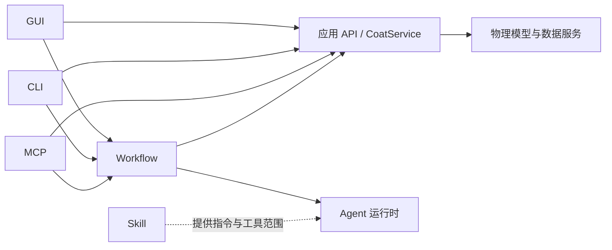

# 工作流引擎

本项目把界面、命令行和 MCP 看作不同入口。它们最终应调用同一组应用服务；工作流再按顺序组合这些服务调用和 Agent 节点。MCP 不启动 CLI 子进程，CLI 与 MCP 也不各自实现一份业务规则。



## 边界

- `coat_sim/workflow.py` 是可单独拷入其他 Python 系统的轻量引擎；核心只使用 Python 标准库，PydanticAI 仅在调用可选的 Agent 节点适配器时需要。工作流由宿主注册 Python callable，不从配置文件执行任意代码。
- `WorkflowNode(kind="program")` 执行确定性代码；`kind="agent"` 执行 Agent。两种节点共享同一状态、跳转、检查点和事件记录。
- 工作流只协调任务，不拥有膜厚、遮挡或几何公式。相关计算仍由核心算法和 `CoatService` 完成。
- Skill 是 Agent 节点使用的说明和工具范围，不决定工作流跳转。每个节点可用 `skills` 标记所需技能；引擎保留这些元数据，宿主把它们解析为 PydanticAI Harness 的 `Skills` 能力或其他 agent 框架的等价配置。
- 当前本地助手使用 Pydantic AI Harness 管理对话执行、规划和 Agent 步骤。轻量 Workflow Engine 管理跨程序与 Agent 的应用任务流程；二者职责不同，可以组合。

## 状态与恢复

默认存储使用 SQLite 保存 run 快照和追加事件。宿主也可以按 `CheckpointStore` 协议接入自己的数据库。每个检查点包含工作流 ID/版本、初始输入、业务状态、节点输出、当前节点、已执行步数、尝试次数，以及按 Agent 身份隔离的上下文。节点处理器和工作流定义不序列化；宿主在重新启动后要以相同 ID 与版本重新注册定义。

循环通过 `StepResult(next_node="...")` 回到前置节点。默认每个流程最多进入 1000 次节点（包括失败重试和暂停后恢复），可在工作流上设置更小的 `max_steps` 防止意外死循环。`StepResult(wait_for_input="...")` 会暂停在当前节点；收集用户输入后用 `engine.resume(..., response=...)` 继续。宿主可调用 `engine.cancel(run_id)` 停止运行。

重复访问同一个 Agent 节点时，`context.agent_context()` 返回与该节点绑定并已持久化的字典。PydanticAI 适配器 `pydantic_agent_node` 会从这里加载序列化的消息历史，传给下一次 `Agent.run`，然后保存新的完整历史。Pydantic AI 官方接口支持读取 `all_messages_json()` 并把消息历史传给后续 Agent 调用；历史可序列化后保存在应用自己的数据库中（[消息历史](https://pydantic.dev/docs/ai/core-concepts/message-history/)、[持久化](https://pydantic.dev/docs/ai/core-concepts/persistence/)）。

检查点在节点边界写入。若进程在一个有副作用的节点中途退出，该节点会在恢复时重跑；引擎提供稳定的 `context.idempotency_key`，节点应把它传给支持幂等请求的 API。SQLite 检查点不能单独保证外部副作用“恰好执行一次”。Pydantic Agent 节点应按需配置 Harness 的 `StepPersistence` 和上下文压缩，处理模型调用内部的步骤恢复与长上下文；本引擎保存的是 Agent 节点之间的任务状态。超长任务的定时唤醒也由宿主后台运行器负责；引擎负责单次流程的执行、暂停和恢复。

## 最小示例

```python
from coat_sim.workflow import (
    SQLiteCheckpointStore, StepResult, Workflow, WorkflowEngine,
    WorkflowNode, pydantic_agent_node,
)

engine = WorkflowEngine(SQLiteCheckpointStore("artifacts/workflows.sqlite3"))

async def load_and_validate(ctx):
    document = service.load("process", ctx.input["process_path"])
    validation = service.validate("process", path=ctx.input["process_path"])
    return StepResult(output={
        "document": document.data,
        "valid": validation.valid,
        "issues": list(validation.issues),
    }, next_node="advise")

advisor = pydantic_agent_node(
    "advise", agent,
    prompt=lambda ctx: "分析这个工艺并提出可验证的改进建议："
        + str(ctx.outputs["inspect"]),
    next_node=None,
    skills=("coat-mcp",),
)

workflow = Workflow(
    workflow_id="coat.process_review", version="1", start_node="inspect",
    nodes=(WorkflowNode("inspect", load_and_validate, next_node="advise"), advisor),
    max_steps=20,
)
run = await engine.run(workflow, {"process_path": "data/process/example.json"})
```

本项目的 MCP `create_default_workflow` 已改由该引擎执行两个程序节点：在 `data/tmp/workflows` 生成并校验演示设计，再按请求提交仿真。对话中新设计默认临时暂存；用户决定正式保存时确认名称并使用对应保存工具。稳定的客户端请求 ID 同时用作工作流 run ID；重复请求会恢复或读取原 run，并继续核对同一个计算作业。

## 当前不负责的能力

- 后台守护进程、定时触发、队列和多机调度由宿主提供。
- 对话记忆与跨对话长期记忆由 Agent/Harness 或宿主存储管理；引擎只保留一个 workflow run 内的节点上下文。
- 任意并行 DAG、补偿事务、分布式锁和多租户权限不是本引擎目标；出现真实需求时再扩展存储协议或改用成熟调度系统。

## 固定的自定义工程管线

`create_design_workflow` 一次接收结构化多源、多板、基片、机器、监测点、工艺层及仿真/导出选项。对话新生成的设计先通过 `prepare_temporary_design` 暂存于 `data/tmp`；决定正式保存后由 `save_generated_design` 在用户确认名称后复制完整依赖图到 kind 正式目录。固定工作流自身按 prepare → submit → await → export 推进；每次仿真尝试（成功、失败或取消）在 `data/simulation_history.sqlite3` 记录摘要。成功时自动生成临时结果包及标准热图；失败或取消只记录请求、状态和错误，不生成厚度指标。正式保存仿真资产时先确认名称，再用 `save_simulation_asset` 保存为 `.coatasset`，可由仿真界面从 `data/assets` 打开，也可用 `read_simulation_asset` 分视图读取。主助手运行时由程序等待并推进，独立 MCP 客户端用 `advance_design_workflow` 继续，`design_workflow_status` 查询节点事件，`cancel_design_workflow` 取消。

结果分析优先复用 `read_calculation_result` 返回的 `files[].heatmap` 或已有结果文件；只有额外需要等高线、径向图等视图时才调用 `visualize_calculation_result`。PDF默认包括 heatmap、thickness、uniformity，可选 computation、settings、machine、process、layers。

同请求不能改变契约，已有自有文件须内容一致；拒绝覆盖未知文件。导出恢复核对原 run ID 与完整文件摘要。Agent适合判断目标、合法参数和结果说明，常规依赖保存与计算执行已由程序固化。

## 稳定性语义

SQLite运行租约默认60秒、每20秒续约，owner绑定执行上下文；租约过期的旧执行不能借新owner提交。节点写入临时状态，输出和后继节点校验后才提交；异常回滚未提交的state/output/agent memory，保留错误事件。节点重试保持当前访问的幂等键，正常循环重访获得新访问键。显式取消在开始下一节点和提交返回值前检测，即使节点吞掉取消异常也停止。

外部文件/作业不受内存回滚影响，恢复必须核对业务身份与内容。同步长节点需要宿主自行异步化或to_thread；线程不能安全强停，本引擎不声称事务性恰好一次或分布式调度。

## 真实验收入口

`tools/verify_workflows.py` 在隔离目录验证恢复、取消、同运行互斥、节点上下文与复杂真实仿真/PDF/网格/沙箱绘图。`tools/verify_assistant_workflow.py --live` 为显式可选的真实模型验收，使用当前配置与安全凭据，并有请求/输出/总Token预算；不含密钥。引擎与核心证据写入 artifacts/workflow-verification，真实模型证据写入 artifacts/debug，测试记录与生产问题日志分开。实际验收结果以本次报告为准，不能以测试Agent替代真实模型或以宿主绘图替代OS沙箱。

## 2026-10-01 本地验收记录

17 个场景通过：完整场景 14 项、独立进程锁与真实作业取消 2 项、助手自动推进状态回归 1 项（含成功、导出返回失败、导出请求异常三个分支）。双源不同高度、双修正板、多基准三层工艺使用实际核心计算，PDF 与网格是真实导出；可视化在 LPAC 沙箱内读取实际网格生成。Agent 节点上下文使用 PydanticAI TestModel，自动推进边界使用明确的响应夹具，二者不计为真实外部模型调用。

- 完整 14 项证据（历史验证记录，未随公开源码发布）
- 跨进程锁与真实取消证据（历史验证记录，未随公开源码发布）
- 自动推进与导出失败状态证据（历史验证记录，未随公开源码发布）

真实服务商模型验收及其独立复核单独记录，不能用上述测试替代。

### 历史真实模型验收记录（2026-10-01）

以下记录来自该日期留存的运行与复核文件，仅作为历史证据，不表示本轮重新运行了真实模型、界面或性能验收。此前使用已保存的 Ark 服务配置与 doubao-seed-2.1-pro，执行新建双源、双修正板、三层工艺任务。该次使用 3 次模型请求，耗时 83.751 秒；输入 80.064 K、输出 6.822 K，合计 86.886 K Token，缓存读取 10.040 K，服务报告输入缓存命中率 12.54%。请求总量包括重复发送的上下文，不等于最终上下文占用；该单次数据不代表任意任务的成本或性能。

历史任务产生两源（0/80 mm）、两块修正板及三层 2000/4000/8 nm 工艺；留存记录显示仿真和PDF/31×31网格导出成功。参数为齿数120/37、模数4 mm、盘心距314 mm、高度800 mm；4秒薄层使用实际时间采样。记录的均值为6008 nm、CV约0.17334%，仅对应当时未标定的验收参数。

- 历史模型运行摘要（历史验证记录，未随公开源码发布）
- 历史文件、作业与结果独立复核（历史验证记录，未随公开源码发布）
- 历史 PDF 报告（历史验证记录，未随公开源码发布）

同一历史复核文件记录了34项只读检查通过，检查对象为SQLite、JSON、NPZ与PDF；没有为该复核再次调用模型。

## 膜系工艺与图表导出

`create_design_workflow` 支持 `film_stack` 或 `steps` 二选一。膜系支持显式层、周期展开、等厚序列与四分之一波长候选（layer_count与reference_wavelength_nm，材料折射率取materials[].refractive_index）；程序负责展开和保存，最多10000层。工作流的 `export_charts=true` 可固定导出结果图。四分之一波长只提供法向、透明实数n的候选厚度，不等于光谱验证。

厚度表导入支持CSV/TSV/TXT/XLSX/JSON；多sheet、厚度单位、输入层序须明确，公式须先转成值。已有层表以分页读取或最多64项字段patch局部修改。结果可视化由 `visualize_calculation_result` 固定生成PNG/CSV；工作流对话默认保持摘要，按需指定detail/offset/limit，避免搬运完整网格。现有图文件可复用。

